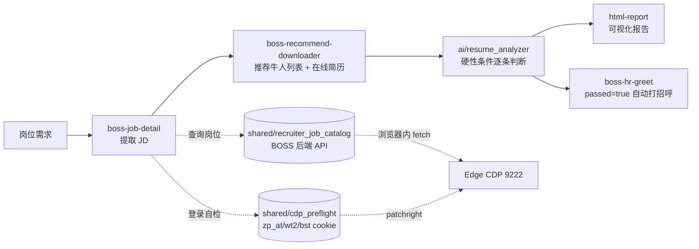

# BOSS 直聘 · HR 智能体技能包

> [!NOTE]
> 由 **5 个 AI 智能体 Skill** 组成，基于 patchright + CDP 直连真实 Edge 浏览器（共享 wt2/zp_at/bst cookie），实现 BOSS 直聘简历筛选的**全流程自动化**：从岗位到可视化报告，一键搞定。
>
> **统一入口 CLI `boss-hr`**：所有 Agent / 用户通过 [`boss-hr` 命令](docs/CLI_WORKFLOW.md)（`boss-hr start / confirm / fetch / automate / report / greet / status`）调用本工具包。**禁止直接调用底层脚本**。详见 [`boss-hr-auto/SKILL.md`](boss-hr-auto/SKILL.md)。
>
> **自包含**：不依赖第三方 BOSS CLI。所有 BOSS HTTP 调用走浏览器内 fetch（自动带 cookie + TLS 指纹），岗位查询走 `shared/recruiter_job_catalog.py`，登录检测走 `shared/cdp_preflight.py`。
>
> **当前发布形态**：**GitHub 源码工具包 + editable install**（`pip install -e .`）。**不是**独立 wheel，**不**依赖移动源码后仍能运行。移动源码后必须重新 `pip install -e .` 才能继续使用 `boss-hr` 命令。

<p align="center">
  
  
  
  
</p>

---

## 📑 目录

- [✨ 这是什么](#-这是什么)
- [🎯 核心能力](#-核心能力)
- [🧩 技能一览与工作流](#-技能一览与工作流)
- [🚀 快速开始](#-快速开始-cli-工作流)
- [✅ 硬性条件筛选（无评分）](#-硬性条件筛选无评分)
- [🛡️ 安全与风控](#️-安全与风控)
- [📂 项目结构](#-项目结构)
- [📤 输出文件](#-输出文件)
- [⚙️ 环境变量](#️-环境变量)
- [🔗 相关链接](#-相关链接)

---

## 🚀 快速开始（CLI 工作流）

**前置**：Windows + Python 3.10+ + Edge 浏览器 + `pip install -e .` 安装本工具包。

> **v1.1.2 自动恢复**：**不需要**预先手动启动 Edge，也**不需要**预先跑
> `boss-hr doctor`。直接 `boss-hr start` 即可：
>
> - 9222 已开 + 已登录 → 立即进入业务；
> - 9222 未开 → 自动启动**自动化专用 Edge**
>   （`--user-data-dir=%LOCALAPPDATA%\boss-hr-edge-profile` +
>   `--remote-debugging-port=9222`，与日常 Edge 互不冲突、可同时开着）；
> - 自动启动后未登录 → 自动打开 BOSS 招聘者登录页，轮询等待（默认 20s）；
> - 超时未登录 → 返回 `status=waiting_user_login`（**不是错误**），
>   `next_action=retry_same_command`，**不创建 run**；
> - 用户在专用 Edge 窗口内登录后，**重试同一条 start** 即可继续。
>
> `boss-hr doctor` 仍是独立诊断工具，但**不再是 start 的必经前置**。

```bash
git clone https://github.com/<owner>/boss-hr-agent-toolkit
cd boss-hr-agent-toolkit
python -m pip install -e .

# 验证安装
boss-hr --help          # 应列 9 个公开命令（含 doctor / sync-jobs）
python -m boss_hr --help # 等价入口
```

完整 9 命令工作流（详见 [docs/CLI_WORKFLOW.md](docs/CLI_WORKFLOW.md)）：

```bash
# 0.（可选）同步 BOSS 实时岗位到 .env（岗位改名/重发后跑一次；
#    定时任务 tools/scheduled_boss_run.py 默认已内置此步）
boss-hr sync-jobs

# 1. 直接创建新 run（停在人工确认门；v1.1.2 自动启动 Edge + 等登录）
#    v1.2.1：confirm 及之后的所有命令，--job-name / --encrypt-job-id 均可省略
#    （默认岗位 app.default_job_name + .env 的 BOSS_JOB_ID_* 自动解析）
boss-hr start "<encryptJobId|jobId|岗位名>" \
  --job-name "<岗位名>" --encrypt-job-id "<id>"
# → status=waiting_user_confirmation，run_id=...
# → 智能体停下，告知用户在 BOSS 推荐牛人页面调整筛选条件
# 若 start 返回 status=waiting_user_login：智能体停下，告知用户在专用
# Edge 中登录后重试同一条 start

# 用户回复"继续"后：
# 2. confirm
boss-hr confirm --job-name "<>" --encrypt-job-id "<>" --run-id "<rid>"

# 3.（用户明确批准后）automate 一键链路：
#    抓取 + 卡片预筛 → AI 硬性条件分析 → SQLite/飞书落库 → 自动打招呼
boss-hr automate --job-name "<>" --encrypt-job-id "<>" --run-id "<rid>" \
  --count N --max-greetings M
# → status=automation_complete；可先加 --dry-run 演练（不真发招呼）

# 可选：只抓取不分析（排障/预览用）
boss-hr fetch   --job-name "<>" --encrypt-job-id "<>" --run-id "<rid>" --count N

# 4. report
boss-hr report  --job-name "<>" --encrypt-job-id "<>" --run-id "<rid>"

# 5.（可选 + 用户明确批准时）greet — 这是**真实写操作**
boss-hr greet   --job-name "<>" --encrypt-job-id "<>" --run-id "<rid>"

# 6. 任意时点查看当前 run 状态
boss-hr status  --job-name "<>" --encrypt-job-id "<>" --run-id "<rid>"
```

> ⚠️ **当前限制（GitHub 首版）**：
> - 不支持 `continue` / `batch` / 多批累计
> - 仅在 Windows 上完整验证过；macOS / Linux 需自测

---

## ✨ 这是什么

你有一个岗位，剩下的交给 AI：

```
   岗位          →   AI 自动提取 JD   →   自动下载候选人简历   →   硬性条件判断   →   自动打招呼 + 可视化报告
(一句话需求)        (boss-job-detail)      (boss-recommend-downloader)    (config/jobs + AI)    (boss-hr-greet + html-report)
```

**一句话概括：** AI 帮你在几十份简历中，几分钟内按岗位硬性条件筛出合格的那几个，自动给通过的候选人打招呼，并告诉你该和每个人聊什么。

---

## 🎯 核心能力

| 能力 | 说明 |
|:----:|------|
| 🔍 **JD 提取** | 一键抓取岗位详情、任职要求与核心技能点 |
| 📥 **简历获取** | 从推荐牛人页面获取完整简历，真实浏览器指纹，低风控 |
| ✅ **硬性条件筛选** | 卡片预筛按 `config/jobs/<岗位>.yaml` 拦截；AI 语义理解在线简历逐条对照硬性要求，输出通过/不通过及原因 |
| 📬 **自动打招呼** | 给硬性条件通过（passed=true）的候选人自动点 BOSS 打招呼按钮 |
| 📊 **可视化报告** | 筛选结果表 + 个性化沟通建议，HTML 一键生成 |
| 🧪 **可测试** | 核心算法由 `tests/` 单元测试用例覆盖 |

> **🚪 `boss-hr-auto` 是唯一入口**，其余 Skill 是其子步骤。使用时始终从 `boss-hr-auto` 开始。

> **🆕 v2 接口（2026-07-29+）**：6 个 CLI 脚本全部接受 `--encrypt-job-id`（或 env `BOSS_HR_ENCRYPT_JOB_ID`），目录名从中文岗位名改为 BOSS 的 `encryptJobId`。详见 [📤 输出文件](#-输出文件新设计--2026-07-29) 章节。

---

## 🧩 技能一览与工作流

| # | Skill | 角色 | 作用 |
|:-:|------|:----:|------|
| 0 | **boss-hr-auto** | 🚪 入口 | 编排全流程工作流（唯一入口，5 步串到底） |
| 2 | boss-job-detail | Step 1 | 提取岗位 JD |
| 3 | **boss-recommend-downloader** | Step 2 | 从推荐牛人页面获取完整简历（含卡片预筛） |
| 4 | ai + config/jobs | Step 3 | AI 语义理解在线简历，按岗位 yaml 硬性条件逐条判断 |
| 5 | html-report | Step 4 | 生成可视化 HTML 报告 + 沟通建议 |
| 5+ | **boss-hr-greet** | Step 5 | 给硬性条件通过的候选人自动打招呼（主流程自动触发） |
| lib | shared/cdp_preflight | 基础 | CDP 连接 + 登录态探测 |
| lib | shared/recruiter_job_catalog | 基础 | 招聘者岗位列表 + encryptJobId 解析 |

### 工作流示意图



虚线箭头表示**底层依赖**：`boss-job-detail` 通过 `recruiter_job_catalog` 查岗位列表，
每个 Step 入口通过 `cdp_preflight` 自检登录态；二者都通过 patchright 连到本地
Edge 9222 端口（共享同一份 wt2/zp_at/bst cookie）。

---

## 🚀 快速开始

> **无需打包任何二进制文件。** 以下全部通过包管理器安装，浏览器用系统自带的即可。

### 前置依赖

| 依赖 | 说明 | 安装方式 |
|------|------|---------|
| Python 3.10+ | 运行脚本 | [python.org](https://python.org) |
| patchright | CDP 客户端（**不含浏览器，不下载 Chromium**） | `pip install patchright` |
| Chrome / Edge | 系统自带即可 | 已装直接跳过 |

### 1. 安装

```bash
# Python 依赖（patchright 是唯一第三方依赖）
pip install patchright
```

### 2. 启动 CDP 浏览器（通常由 start 自动启动）

**正常流程无需手动启动**：`boss-hr start` 会自动启动**自动化专用 Edge**
（`--user-data-dir=%LOCALAPPDATA%\boss-hr-edge-profile` +
`--remote-debugging-port=9222`），并打开 BOSS 登录页等待登录。

> ⚠️ **为什么必须用独立 user-data-dir（Edge 136+ 安全限制）**：
> Chromium 136+（Edge 同步继承）在**默认用户数据目录**上会**静默忽略**
> `--remote-debugging-port`——参数出现在命令行里但端口永远不监听，
> 因此"日常 Edge + CDP"不可行，CDP 必须配非默认 `--user-data-dir`。
> 专用目录与日常 Edge 互不冲突（Chromium 单例按 profile 目录隔离），
> 日常 Edge 可以照常开着。
>
> **BOSS 登录须知**：BOSS 单账号活跃会话会互踢——请只在**专用 Edge**
> 里登录/使用 BOSS 招聘者后台，不要同时在日常 Edge 里登录同一账号，
> 否则两边会互相顶掉登录态。

仅当自动启动失败、或你希望手动控制时，使用下面命令：

**Windows（推荐自带 Edge）：**

```powershell
Start-Process "msedge" -ArgumentList `
  "--user-data-dir=$env:LOCALAPPDATA\boss-hr-edge-profile", `
  "--remote-debugging-port=9222", `
  "--disable-blink-features=AutomationControlled", `
  "--lang=zh-CN"
```

**macOS / Linux：**

```bash
google-chrome \
  --user-data-dir="$HOME/.boss-hr-edge-profile" \
  --remote-debugging-port=9222 \
  --disable-blink-features=AutomationControlled \
  --lang=zh-CN
```

### 3. 登录

在打开的**专用 Edge** 窗口里**人工扫码登录 BOSS 招聘者**（一次即可，
登录态保存在专用 profile 中），登录态会被 9222 端口的浏览器 session 持有。

start / fetch / greet 都会自动在专用 Edge 中打开 BOSS 登录页，等待用户
登录后继续。`boss-hr doctor` 也支持 `--launch-edge` 手动启动专用 Edge。

验证脚本会自动检查 `zp_at` / `wt2` / `bst` 三 cookie 是否齐全，无须手动命令。可以用 shared 模块快速自检：

```python
from shared.cdp_preflight import connect_cdp, check_login
session = connect_cdp()        # 默认连 http://localhost:9222
print(check_login(session))    # {'logged_in': True/False, 'cookies': {...}, ...}
```

### 4. 开始使用

在智能体中调用：

```
@skill://boss-hr-auto 车架工程师
```

或直接说：

```
帮我筛选车架工程师的简历
```

---

## ✅ 硬性条件筛选（无评分）

> v1.2 起**移除 AI 评分**。筛选只分两层，判断标准全部来自
> `config/jobs/<岗位>.yaml`。

### 第 1 层：卡片预筛（fetch 阶段，无 AI）

按岗位 yaml 的 `card_prescreen` 检查 BOSS 推荐卡片：

| 条件 | 配置项示例 |
|------|-----------|
| 活跃状态 | `active_status_keywords: ["刚刚活跃", "在线"]` |
| 年龄上限 | `max_age: 30` |
| 最低学历 | `min_degree: 高中` |
| 期望城市 + 岗位关键词 | `city_keyword: 深圳` / `role_keyword: 主播` |

全部满足才点击并逐屏截取完整在线简历；未通过写 `process/card_prescreen_rejected.json` 审计。

### 第 2 层：AI 语义理解（automate 阶段）

把在线简历原文 + 岗位 yaml 中的硬性要求交给 AI（`ai/resume_analyzer.py`，
prompt 见 `config/prompt/review_resume.md`）逐条对照：

- 输出仅两字段：`passed`（是否满足全部硬性条件）+ `reason`（逐条判断依据）
- 任何一条不满足 → 不通过；简历缺关键信息 → 视为无法确认，按不通过处理
- 结果写 `process/screening_results.json` + SQLite + 飞书多维表格（字段一一对应）
- `passed=true` 才进入自动打招呼名单

调整筛选标准 = 改岗位 yaml，不需要动代码。

---

## 🛡️ 安全与风控

### 推荐牛人下载

| 做法 | 说明 |
|:----:|------|
| ✅ 真实浏览器 TLS 指纹 | 通过 patchright 在 Edge 内 fetch，服务器无法区分真人 |
| ✅ 滚动延迟 3-6 秒随机 | 模拟真人浏览 |
| ✅ 简历获取 60-120 秒随机（每 5 人触发一次长延迟） | 模拟真人阅读 + 风控 |
| ✅ 建议工作时间运行 | 9:00-18:00 |
| ✅ 单次建议不超过 50 人 | 超过则分批次 |

### 通用规则

- ❌ 不自动发消息（CLI 权限不足）
- ✅ 批量操作间隔随机延迟
- ✅ 增量同步（已下载简历自动跳过）
- ✅ Cookie 优先从浏览器本地提取

### 风控检测维度

| 维度 | 安全做法 | 危险做法 |
|------|---------|---------|
| 请求频率 | 5-20 秒随机 | 固定间隔或高频 |
| 操作时间 | 工作时间 | 凌晨 |
| 行为模式 | 有滚动有停顿 | 纯 API 无页面交互 |
| 总量控制 | 分批次 | 一次几百个 |

### 浏览器层防风控增强（2026-10）

`shared/anti_detection.py` 在**不改业务主流程**的前提下，为所有浏览器入口
（`boss_jd` / `recommend_list` / `recommend_download` / `auto_greet` /
`start` / `doctor` / `sync-jobs`）统一加四层防护：

| 层 | 能力 | 实现 |
|----|------|------|
| 行为层 | 逐字输入、拟人点击 | 消息按 **38~125ms** 随机间隔逐字输入，换行用 `Shift+Enter`（不会提前发送）；鼠标按下时长 **55~180ms** 随机 |
| 页面层 | 降低自动化特征 | `navigator.webdriver=false`（prototype getter + 原生 `toString` 形态）；清理 `__playwright` / `cdc_*` 等全局；包装 `console` 大对象参数，干扰 DevTools 时间差检测；`console.clear` 改为空函数 |
| 网络层 | 拦截检测与上报 | 阻断 `risk-detection`、`zhipin-security/web/boss`（Aegis）脚本；`logapi` / `apm-fe` / `warlock` / `shink` 上报在本地直接返回 **HTTP 204**，不出网 |
| 熔断层 | 风控异常熔断 | **60 秒内第 4 次**跳转 403/verify/security 页，或**同一 URL 15 秒内加载 5 次**，立即停止自动操作：打印 JSON（退出码 30）并提示人工完成验证。验证页本身**不拦截**，滑块/扫码可正常加载 |

补充说明：

- 启动 Edge 时额外带 `--disable-blink-features=AutomationControlled --lang=zh-CN`；
  仍保持**有窗口**模式（无头模式被观测到更容易触发账号限制）。
- 熔断只记录状态、不自动跳回、不关闭浏览器；事件写入
  `logs/risk_guard_events.jsonl`，方便事后判断是平台风控还是脚本被拦导致的自刷新。
- 逐字输入失败时自动回退到原来的 JS 赋值，保证消息仍能发出，功能不退化。
- 所有开关都可以关闭（默认全开）：

| 环境变量 | 默认 | 作用 |
|---|---|---|
| `BOSS_HR_ANTI_DETECT=0` | 开 | 关闭页面注入 + 请求拦截（保留熔断） |
| `BOSS_HR_RISK_GUARD=0` | 开 | 关闭风控页 / 刷新循环熔断 |
| `BOSS_HR_BLOCK_SECURITY_SCRIPTS=0` | 开 | 不阻断风控检测脚本 |
| `BOSS_HR_BLOCK_REPORTS=0` | 开 | 不拦截日志/监控上报 |
| `BOSS_HR_CONSOLE_SANITIZE=0` | 开 | 不包装 `console`（保留对象展开调试能力） |
| `BOSS_HR_ALLOW_CONSOLE_CLEAR=1` | 关 | 保留页面原本的 `console.clear()` |
| `BOSS_HR_TYPING_MIN_MS` / `BOSS_HR_TYPING_MAX_MS` | 38 / 125 | 逐字输入间隔 |
| `BOSS_HR_CLICK_MIN_MS` / `BOSS_HR_CLICK_MAX_MS` | 55 / 180 | 鼠标按下时长 |
| `BOSS_HR_RISK_LOG` | `logs/risk_guard_events.jsonl` | 熔断事件日志路径 |
| `BOSS_HR_ANTI_DETECT_DEBUG=1` | 关 | 把拦截/安装细节打到 stderr |

> 如果 BOSS 页面出现「加载不出候选人 / 接口异常」，先设
> `BOSS_HR_BLOCK_SECURITY_SCRIPTS=0` 重跑，确认是否是安全 SDK 拦截导致；
> 需要人工过验证时不要关浏览器，验证页会正常显示。

---

## 📂 项目结构

```
boss-hr-agent-toolkit/
├── README.md                          # 本文件
├── FILE_MANAGEMENT.md                 # 文件管理规范
├── .gitignore
│
├── boss-hr-auto/                      # 🚪 全流程编排（唯一入口，纯文档）
│   └── SKILL.md                        # 智能体按此文档顺序调用各子 Skill 脚本
│
├── boss-job-detail/                   # Step 1：JD 提取
│   ├── SKILL.md
│   └── scripts/boss_jd.py
│
├── boss-recommend-downloader/         # Step 2：推荐牛人列表 + 在线简历
│   ├── SKILL.md
│   └── scripts/
│       ├── recommend_list.py          # 获取候选人列表 + 卡片预筛
│       ├── recommend_download.py      # 批量获取简历（patchright + fetch）
│       └── run_all.py                 # 一键运行（list + download）
│
├── ai/                                # Step 3：AI 硬性条件判断（无评分）
│   ├── client.py                      # LLM HTTP 客户端
│   ├── resume_analyzer.py             # 简历语义理解 → passed + reason
│   └── message_generator.py           # 招呼语生成
│
├── html-report/                       # Step 4：报告生成
│   ├── SKILL.md
│   ├── scripts/generate_html_report.py
│   └── templates/report.html
│
├── boss-hr-greet/                     # Step 5：自动打招呼（主流程自动触发）
│   ├── SKILL.md
│   └── scripts/auto_greet.py          # 位置表 + 倒序招呼
│
├── shared/                            # 共享工具
│   ├── output_manager.py              # 统一文件路径管理
│   ├── run_orchestrator.py            # 跨 Step run_id 编排
│   ├── job_resume_store.py            # 候选人键 + 状态读写 + 简历合并
│   ├── human_interaction.py           # 拟人鼠标移动 + 逐字输入
│   ├── anti_detection.py              # 浏览器层防风控（注入/拦截/熔断）
│   └── fix_encoding.py                # 编码修复
│
└── tests/                             # 单元测试
    ├── conftest.py
    ├── test_card_prescreen.py
    └── test_recruit_workflow.py
```

---

## 📤 输出文件（新设计 · 2026-07-29+）

> **目录名 = BOSS 的 `encryptJobId`**（不再是中文岗位名）。`job_name`（中文岗位名）只作为 `jobs.json` 里的可读元数据。这样做的核心原因：避免中文路径在 URL/文件 IO 里的编码翻车；6 个 CLI 脚本统一通过 `--encrypt-job-id`（或 env `BOSS_HR_ENCRYPT_JOB_ID`）透传给 `JobOutputManager`，**路径选择集中在 shared 层**。

```
data/runs/                                        # 工作区根（相对项目根目录）
├── jobs.json                                      # JobRegistry：encryptJobId → {name, company}
└── <encryptJobId>/                                # 例如 9a7759badfd95d350nFz3d-_F1NX
    ├── state/                                     # 跨 run 保留（不覆盖）
    │   ├── candidate_pool.json
    │   ├── download_state.json
    │   ├── resumes_master.json                    # 累计简历（含 _meta）
    │   ├── collection_state.json
    │   └── geek_positions.json
    └── runs/                                       # 每次筛选任务一个 run_id 子目录
        └── <run_id>/
            ├── <run_id>_screening_report.html     # 最终 HTML 报告
            └── process/                            # 过程文件（留痕查阅）
                ├── job_detail.json                 # Step 1 输出
                ├── recommend_geek_ids.json         # Step 2a 输出
                ├── card_prescreen_rejected.json    # Step 2a 卡片预筛审计
                ├── new_resumes.json                # Step 2b 输出
                ├── screening_results.json          # Step 3 AI 硬性条件判断结果
                ├── failed_resumes.json
                └── greet_log.json                  # Step 5 输出
```

### 🚨 严格模式（缺 `--encrypt-job-id` 直接报错）

5 个 CLI 脚本（`boss_jd.py` / `recommend_list.py` / `recommend_download.py` / `generate_html_report.py` / `auto_greet.py`）**必须传 `--encrypt-job-id`**（或 env `BOSS_HR_ENCRYPT_JOB_ID`）。缺则：

```
ValueError: 缺少 encrypt_job_id。
  传 --encrypt-job-id，或设置 env BOSS_HR_ENCRYPT_JOB_ID
```

不会静默回退到中文目录名——避免你以为跑了新路径、实际又落到中文路径的事故。

> [!TIP]
> - 禁止在桌面散落文件；HTML 报告放 run 目录（文件名含 run_id，永不覆盖历史），中间数据放 `process/`
> - 临时 Python 脚本任务结束后删除
> - 复用 skill 内已有的 Python 脚本，禁止重复造轮子
> - 同一 job 的 5 步脚本必须传**同一个** `--encrypt-job-id` 和 `--run-id`
>
> 详见 [FILE_MANAGEMENT.md](FILE_MANAGEMENT.md)。

---

## ⚙️ 环境变量

| 变量 | 说明 | 默认值 |
|------|------|--------|
| `BOSS_BIN` | boss CLI 路径 | `boss` |
| `CDP_URL` | 浏览器 CDP 调试地址 | `http://localhost:9222` |
| `BOSS_HR_OUTPUT_DIR` | 工作区根 | `data/runs` |
| `BOSS_HR_ENCRYPT_JOB_ID` | BOSS 加密岗位 ID（=工作区子目录名） | 缺则 `ValueError` |
| `PYTHONHOME` | **必须清空** | `""` |
| `PYTHONIOENCODING` | 避免 CLI 编码问题 | `utf-8` |

---

## 🔗 相关链接

- [patchright](https://github.com/Kaliiiiiiiiii-Vinyzu/patchright) — Playwright 分支（CDP 浏览器控制）

---

## 📄 License

[MIT](https://opensource.org/licenses/MIT)
